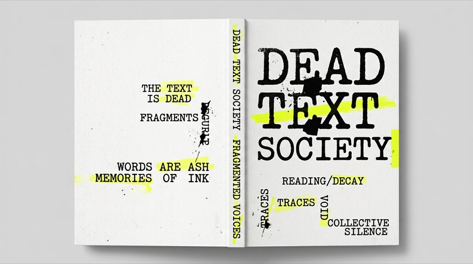

# DEAD TEXT SOCIETY — Reanimate Dormant Notes & Transcripts

<p align="center">
  
</p>

> **"Give dead content another life."**  
> A typographic, local-first intellectual laboratory featuring 142 prompt transformations to breathe new perspectives, critiques, and unexpected angles into raw transcripts, lecture notes, PDFs, and dormant drafts.

[](https://dead-text-society.netlify.app/)
[](https://github.com/emaf205/DEAD-TEXT-SOCIETY)
[](LICENSE)

---

## ✦ The Genesis & Why This Exists

I teach artificial intelligence and record dozens of hours of lectures, discussions, and workshops. Like most educators and researchers, I initially fell into the standard, unimaginative content recycling treadmill:

$$\text{Voice Recording} \longrightarrow \text{Raw Transcript} \longrightarrow \text{Generic AI Summary} \longrightarrow \text{Predictable Blog Post}$$

It works, but it produces bland, soulless output. It takes rich, spontaneous human dialogue and flattens it into bullet-point corporate mush.

I wanted the exact opposite: **taking the same raw source material and examining it through radically diverse lenses, paradoxical questions, and sharp artistic constraints.**

I built **Dead Text Society** to house **142 curated prompt transformations** designed to act as intellectual catalysts. Instead of merely summarizing a meeting or class, it forces your AI model (ChatGPT, Claude, Gemini, NotebookLM) to look at the text like an adversarial critic, a Victorian dramatist, a forensic investigator, or a speculative fiction author.

---

## ✦ Visual Interface & Screenshots

<p align="center">
  
  
</p>

---

## ✦ What You Can Transform

Feed in raw voice transcripts, meeting minutes, research papers, university notes, book excerpts, or brainstorm dumps.

Transform them into:
- **Literary Narrative & Drama**: Philosophical dialogues, satirical parodies, speculative flash fiction.
- **Forensic & Adversarial Critique**: Steelmanning counter-arguments, finding unstated biases, stress-testing fragile assumptions.
- **Visual & Graphic Concepts**: Metaphorical poster briefs, editorial wireframes, diagram archetypes.
- **Micro-Pedagogy**: Socratic flashcards, paradoxical examination questions, mental models.
- **Strange Conceptual Collisions**: Forcing your source text to collide with unrelated historical eras, architectural styles, or culinary traditions.

---

## ✦ The Workflow: 4 Seconds to Execution

1. **CHOOSE**: Browse by category, search by keyword, or hit the **Surprise Me** button to break creative paralysis.
2. **COPY**: Click to copy the engineered transformation formula directly to your clipboard.
3. **PASTE & FEED**: Paste into Claude, ChatGPT, Gemini, or local models along with your raw text.
4. **RUN**: Watch dormant transcripts transform into fresh intellectual property.

---

## ✦ Technical Architecture & Principles

- **🔒 100% Client-Side & Zero Backend**:
  - The entire database of 142 prompts and the search engine run locally in the browser.
  - Zero login requirements, zero tracking scripts, zero cookies.
- **⚡ Instant Fuzzy Search**:
  - Filter across all 142 formulas in under 10ms.
- **🎨 Swiss Typographic Restraint**:
  - High-contrast monochromatic palette, generous negative space, typewriter-grade readability.
  - Built with pure HTML5, vanilla CSS, and ES6+ JavaScript.

---

## ✦ Quickstart & Offline Execution

```bash
# Clone the repository
git clone https://github.com/emaf205/DEAD-TEXT-SOCIETY.git
cd DEAD-TEXT-SOCIETY

# Unpack and launch
unzip dead-text-society-app.zip -d app
open app/index.html
```

Or open the live deployment directly in your browser:  
👉 **[https://dead-text-society.netlify.app/](https://dead-text-society.netlify.app/)**

---

## ✦ Author & Credits

Conceived and designed by **[Emanuele BDC](https://emaf205.com)** in Milan.  
For thinkers, writers, and educators who refuse to let good ideas die in unopened folders.

Distributed under the **MIT License**. Free for personal and educational exploration.
